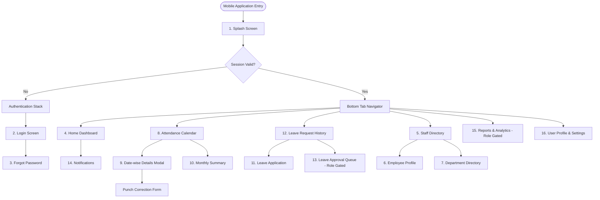
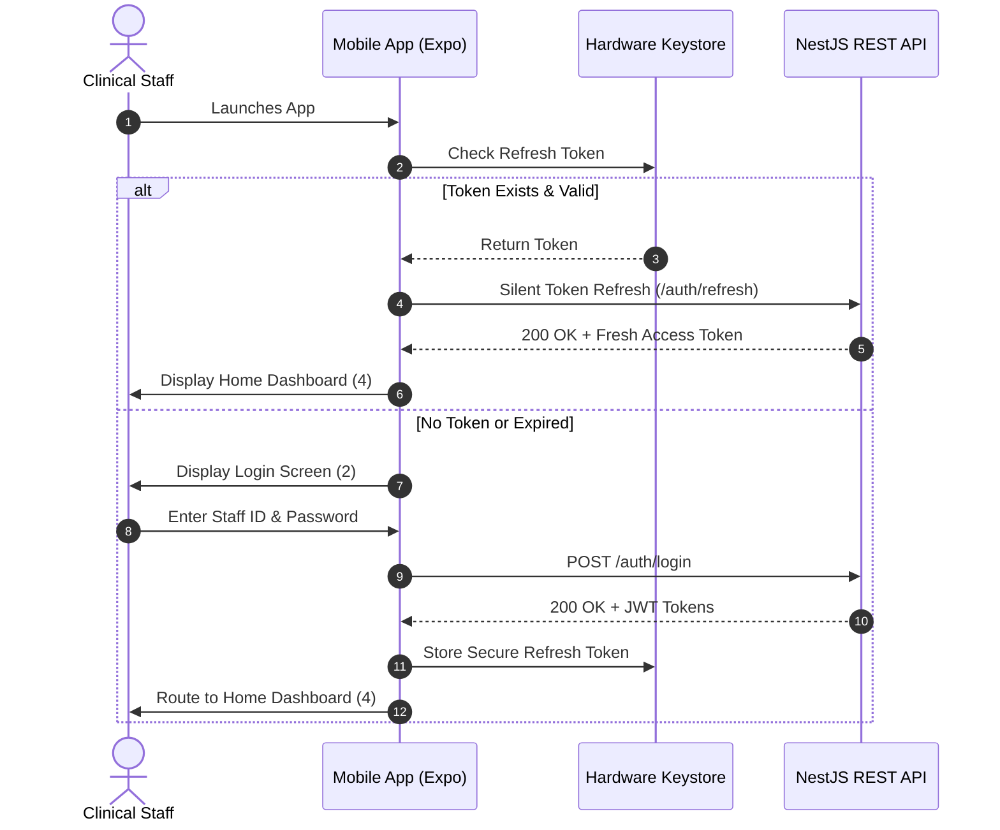
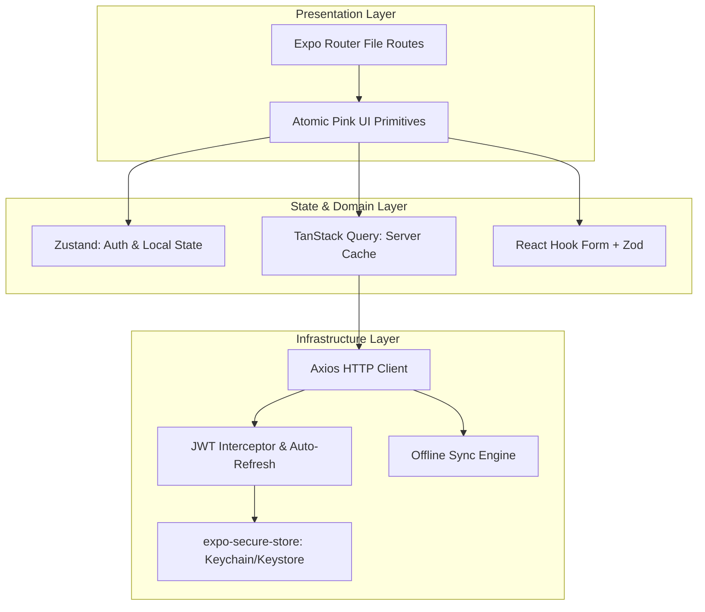
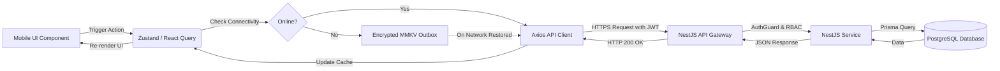
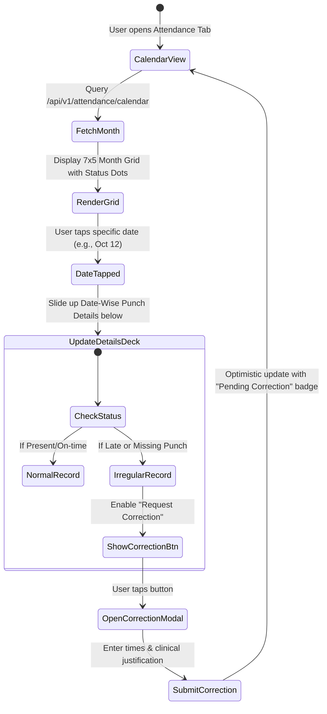
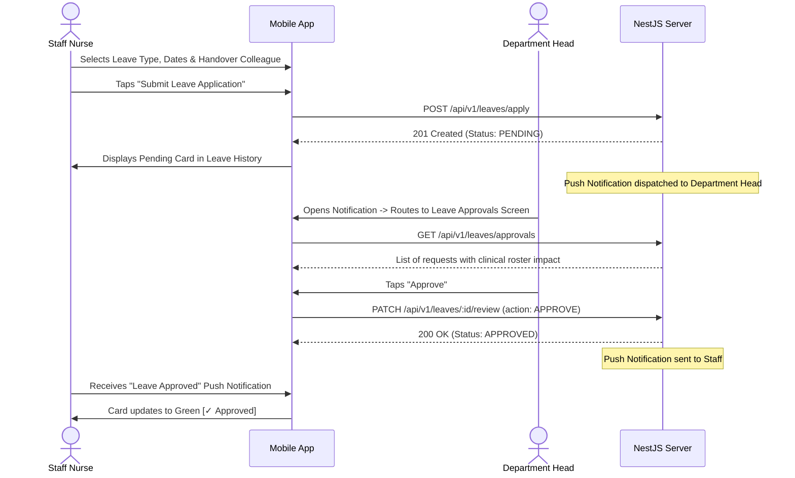

# 08 - Miro Board Deliverables & Engineering Roadmap

This document provides structured board blueprints, Mermaid diagrams, relationship flows, and an MVP engineering roadmap designed for representation on a collaborative Miro board or FigJam canvas.

---

## Miro Board Master Layout Structure

```
+---------------------------------------------------------------------------------------------------+
|                                  CAREPULSE HR - MIRO WORKSPACE BOARD                              |
+---------------------------------+---------------------------------+-------------------------------+
|  FRAME 1: Mobile App Sitemap    |  FRAME 2: User Navigation Flow  |  FRAME 3: Screen Wireframes   |
|  Hierarchical screen tree       |  End-to-end user journeys       |  Visual mobile UI cards       |
+---------------------------------+---------------------------------+-------------------------------+
|  FRAME 4: Pink Design System    |  FRAME 5: Component Hierarchy   |  FRAME 6: Mobile Architecture |
|  Tokens, palettes, typography   |  Atomic component tree          |  Internal layers & modules    |
+---------------------------------+---------------------------------+-------------------------------+
|  FRAME 7: Mobile Data Flow API  |  FRAME 8: Attendance Flow       |  FRAME 9: Leave Approval Flow |
|  JWT, Axios, NestJS & offline   |  Calendar tap & punch drilldown |  Application to review state  |
+---------------------------------+---------------------------------+-------------------------------+
|  FRAME 10: Role Access Matrix   |  FRAME 11: Testing Strategy     |  FRAME 12: MVP Roadmap        |
|  RBAC permissions grid          |  Jest, RNTL, Maestro, Supertest |  Phased rollout schedule      |
+---------------------------------+---------------------------------+-------------------------------+
```

---

## Deliverable 1: Mobile Application Sitemap



---

## Deliverable 2: User Navigation Flowchart



---

## Deliverable 3: Mobile Screen Layout Hierarchy

```
+---------------------------------------------------------------------------------+
| SCREEN 4: HOME          | SCREEN 8: ATTENDANCE     | SCREEN 11: LEAVE APPLY     |
| +---------------------+ | +----------------------+ | +------------------------+ |
| | Header: User & Bell | | | Month Picker <Oct 26>| | | Leave Type Picker      | |
| | Active Shift Banner | | | 7-Col Calendar Grid  | | | Date Range (From/To)   | |
| | Quick Action Chips  | | | Selected Date Card   | | | Handover Staff Select  | |
| | Monthly Summary Box | | | - In/Out Punches     | | | Reason & Prescription  | |
| | Notice Board Feed   | | | - Shift & Overtime   | | | [SUBMIT APPLICATION]   | |
| | Bottom Tab Bar      | | | [Request Correction] | | +------------------------+ |
| +---------------------+ | +----------------------+ |                            |
+---------------------------------------------------------------------------------+
```

---

## Deliverable 4: Pink Design System Visual Palette

```
+---------------------------------------------------------------------------------+
| TOKEN NAME         | HEX CODE | SWATCH DESCRIPTION      | CLINICAL APPLICATION  |
+--------------------+----------+-------------------------+-----------------------+
| Primary Pink       | #BE185D  | Deep Raspberry Rose     | Primary CTA, Top Bar  |
| Soft Pink          | #FCE7F3  | Gentle Petal Accent     | Badge BG, Active Tab  |
| Canvas Background  | #FFF1F7  | Petal White Tint        | Non-glare Screen BG   |
| Card Surface       | #FFFFFF  | Pure Clean White        | Content Card Panels   |
| Slate Text Primary | #334155  | Slate 700 Contrast      | Headings, Data Values |
| Border Divider     | #E2E8F0  | Slate 200 Hairline      | Card & Input Outlines |
| Present Green      | #16A34A  | Emerald Health Green    | Punched on-time       |
| Late Amber         | #D97706  | Clinical Warning Amber  | Tardy arrival         |
| Absent Red         | #DC2626  | Critical Urgent Red     | Unexcused missed shift|
| Leave Purple       | #7C3AED  | Calming Lavender Purple | Approved absence      |
+--------------------+----------+-------------------------+-----------------------+
```

---

## Deliverable 5: Component Hierarchy

```
AppContainer
├── ThemeProvider (PinkTheme tokens)
├── QueryClientProvider (TanStack Query)
└── NavigationContainer
    └── RootNavigator
        ├── AuthStack (Login, ForgotPassword)
        └── MainTabNavigator
            ├── HomeScreen
            │   ├── ShiftStatusBanner
            │   ├── QuickActionRow (Button, Chip)
            │   ├── AttendanceWidget (Card, Badge)
            │   └── NoticeCarousel
            ├── AttendanceScreen
            │   ├── MonthHeaderControl
            │   ├── CalendarGrid (CalendarCell, StatusPip)
            │   └── DatePunchDetailsCard
            │       ├── PunchTimelineRow
            │       └── CorrectionActionButton
            ├── LeaveScreen
            │   ├── LeaveBalanceDeck (BalanceCard)
            │   └── LeaveHistoryList (LeaveRequestCard, StatusBadge)
            ├── DirectoryScreen
            │   ├── SearchInput
            │   ├── DepartmentFilterScroll
            │   └── StaffCardList (StaffCard, CouncilBadge)
            └── ProfileScreen
                ├── UserInfoHero
                ├── SecuritySettingsList
                └── LogoutButton
```

---

## Deliverable 6: React Native Application Architecture



---

## Deliverable 7: Mobile Data Flow and API Integration Diagram



---

## Deliverable 8: Attendance Calendar Interaction Flow



---

## Deliverable 9: Leave Application and Approval Flow



---

## Deliverable 10: Role-Based Mobile Screen Access Matrix

```
+------------------------------------+-------+-----------+----------+-------------+---------+
| SCREEN NAME                        | STAFF | DEPT HEAD | HR ADMIN | SUPER ADMIN | AUDITOR |
+------------------------------------+-------+-----------+----------+-------------+---------+
| 1. Splash Screen                   |   ✓   |     ✓     |    ✓     |      ✓      |    ✓    |
| 2. Login Screen                    |   ✓   |     ✓     |    ✓     |      ✓      |    ✓    |
| 3. Forgot Password                 |   ✓   |     ✓     |    ✓     |      ✓      |    ✓    |
| 4. Home Dashboard                  |  Self | Dept+Self |  Full    |    Full     |  Audit  |
| 5. Staff Directory                 |  View |   View    |  Edit    |    Full     |  Audit  |
| 6. Employee Profile                |  Self |   Dept    |  Full    |    Full     |  Audit  |
| 7. Department Directory            |  View |   View    |  Full    |    Full     |  Audit  |
| 8. Attendance Calendar             |  Self | Dept+Self |  Full    |    Full     |  Audit  |
| 9. Date-wise Attendance Details    |  Self | Dept+Self |  Full    |    Full     |  Audit  |
| 10. Monthly Attendance Summary     |  Self | Dept+Self |  Full    |    Full     |  Audit  |
| 11. Leave Application Form         |  Self |   Self    |  Proxy   |    Proxy    |    ✕    |
| 12. Leave Request History          |  Self | Dept+Self |  Full    |    Full     |  Audit  |
| 13. Leave Approval Queue           |   ✕   |  Approve  | Override |    Full     |    ✕    |
| 14. Notifications                  |  Self | Dept+Self |  Full    |    Full     |  Self   |
| 15. Reports & Analytics            |  Self |   Dept    |  Full    |    Full     |  Audit  |
| 16. User Profile and Settings      |  Self |   Self    |  Full    |    Full     |  Self   |
+------------------------------------+-------+-----------+----------+-------------+---------+
```

---

## Deliverable 11: Mobile Testing Strategy Board

```
+---------------------------------------------------------------------------------------+
| LAYER               | FRAMEWORK          | KEY TEST CASES                             |
+---------------------+--------------------+--------------------------------------------+
| Component / Forms   | Jest + RNTL        | - Form validation: handover colleague rule |
|                     |                    | - Dynamic font scaling (up to 200%)        |
|                     |                    | - Pink design token styling conformance    |
|                     |                    | - 48x48dp minimum touch boundary tests     |
+---------------------+--------------------+--------------------------------------------+
| Attendance Math     | Jest               | - Late arrival grace period (15m threshold)|
|                     |                    | - Half-day calculation (<4.5 hrs)          |
|                     |                    | - Shift boundary crossing (Night shifts)   |
|                     |                    | - Overtime accumulation accuracy           |
+---------------------+--------------------+--------------------------------------------+
| API Contract        | Supertest          | - NestJS DTO validation                    |
|                     |                    | - JWT expiration and refresh cycle (401)   |
|                     |                    | - RBAC guard rejects unauthorized requests |
+---------------------+--------------------+--------------------------------------------+
| End-to-End Flows    | Maestro            | - Flow 1: Biometric login & calendar swipe |
|                     |                    | - Flow 2: Leave apply -> Handover -> Approve|
|                     |                    | - Flow 3: Airplane mode offline sync test  |
+---------------------+--------------------+--------------------------------------------+
```

---

## Deliverable 12: MVP Development Roadmap

```
+-------------------------------------------------------------------------------------+
| PHASE           | DURATION | CORE DELIVERABLES                                      |
+-----------------+----------+--------------------------------------------------------+
| Phase 1:        | Weeks    | - React Native / Expo SDK foundation setup             |
| Foundation &    | 1 - 2    | - Pink design tokens & atomic components (Cards, etc.) |
| Authentication  |          | - NestJS JWT authentication & SecureStore tokens       |
|                 |          | - Screens: Splash (1), Login (2), Forgot Password (3)  |
+-----------------+----------+--------------------------------------------------------+
| Phase 2:        | Weeks    | - Attendance Calendar top-grid & date-wise bottom-deck |
| Attendance &    | 3 - 4    | - Biometric reader log synchronization                 |
| Shift Engine    |          | - Attendance correction submission & review            |
|                 |          | - Screens: Attendance (8), Details (9), Summary (10)   |
+-----------------+----------+--------------------------------------------------------+
| Phase 3:        | Weeks    | - Leave balance calculations & entitlement rules       |
| Leave Lifecyle  | 5 - 6    | - Clinical duty handover colleague selector            |
| & Directories   |          | - Department Head approval queue & notifications       |
|                 |          | - Screens: Leave Apply (11), History (12), Apprv (13)  |
|                 |          | - Screens: Staff Directory (5), Dept Directory (7)     |
+-----------------+----------+--------------------------------------------------------+
| Phase 4:        | Weeks    | - Nepal medical council tracking (NNC, NPC, NMC, NHPC) |
| Profiles, RBAC  | 7 - 8    | - Role-based dashboard adaptation (Nurse, HOD, Admin)  |
| & Dashboards    |          | - Screens: Home Dashboard (4), Profile (6), Settings(16)|
|                 |          | - Screens: Notifications (14), Reports & Analytics (15)|
+-----------------+----------+--------------------------------------------------------+
| Phase 5:        | Weeks    | - Offline outbox mutation queue & reconnection sync    |
| Hardening, QA   | 9 - 10   | - Maestro E2E test suites on iOS and Android devices   |
| & App Launch    |          | - Accessibility review & performance profiling         |
|                 |          | - Production build generation via EAS Build            |
+-----------------+----------+--------------------------------------------------------+
```
