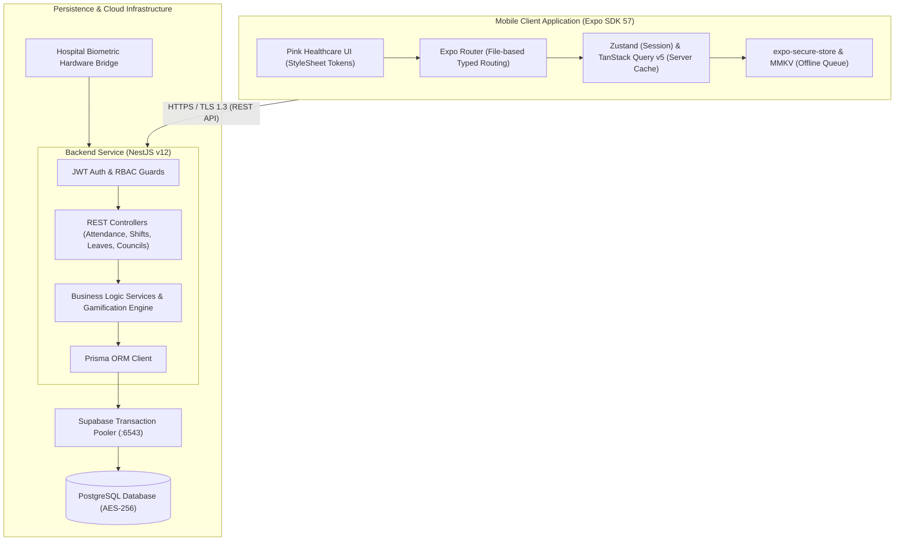
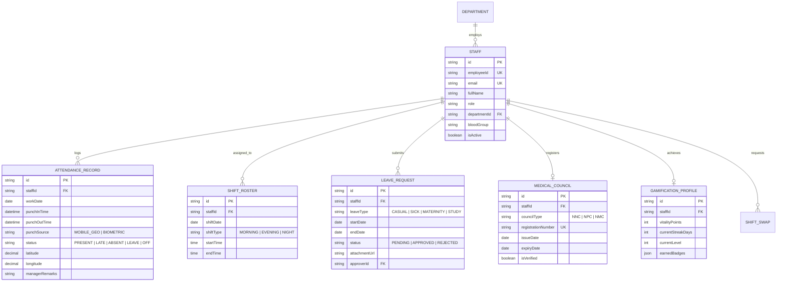

# System Architecture & Technical Design

> **Healthcare HR Management Platform**  
> **Repository:** Monorepo (`Mobile/` + `server/`)  
> **Platform Baseline:** React Native (Expo SDK 57) | NestJS v12 | PostgreSQL & Prisma (Supabase)

---

## 1. High-Level Architecture Overview

The Healthcare HR Management System is engineered as a secure, distributed monorepo featuring a native mobile client for clinical staff and a modular backend REST API service.



---

## 2. Monorepo Structure & Workspace Boundaries

```
hr/
├── Mobile/                  # React Native / Expo Mobile Application
│   ├── assets/              # Static media, icons, splashes
│   ├── src/
│   │   ├── app/             # Expo Router screen routes & layouts
│   │   │   ├── (auth)/      # Login, password reset, biometrics
│   │   │   ├── (tabs)/      # Bottom tab navigation (Dashboard, Calendar, Shifts, Leaves, Profile)
│   │   │   └── _layout.tsx  # Root stack & provider initialization
│   │   ├── components/      # Reusable UI molecules (Cards, Badges, Buttons, Pickers)
│   │   ├── hooks/           # Custom React hooks (useAttendance, useRoster, useAuth)
│   │   ├── services/        # HTTP API client, Axios interceptors, offline sync worker
│   │   ├── stores/          # Zustand global stores (authStore, uiStore, offlineStore)
│   │   └── theme/           # Pink Healthcare design tokens & theme StyleSheet
│   ├── app.json             # Expo config & plugins (CNG)
│   └── package.json         # Mobile dependencies (managed by Bun)
├── server/                  # NestJS REST API Backend
│   ├── src/
│   │   ├── auth/            # Passport JWT strategies, guards, RBAC decorators
│   │   ├── users/           # User & staff profile management
│   │   ├── councils/        # NNC, NPC, NMC medical council licensing verification
│   │   ├── attendance/      # Geofenced punch logs, calendar aggregations
│   │   ├── shifts/          # Roster scheduler, swap engine
│   │   ├── leaves/          # Multi-tier leave workflows & approvals
│   │   ├── gamification/    # Vitality Points, streaks, badge triggers
│   │   ├── prisma/          # Prisma schema, migrations, seeders
│   │   └── main.ts          # Application bootstrap & global pipes
│   ├── test/                # Supertest integration test suites
│   └── package.json         # Backend dependencies (managed by Bun)
├── docs/                    # Exhaustive specifications & system blueprints
├── DESIGN.md                # Machine-readable design tokens
├── PRD.md                   # Product requirements & clinical compliance
├── GDD.md                   # Gamification design document
├── ROADMAP.md               # Multi-quarter product roadmap
├── TESTING.md               # Test harnesses, coverage, and automation guidelines
├── CHANGELOG.md             # Semantic version release records
└── DEVLOG.md                # Chronological engineering journal
```

---

## 3. Mobile Client Architecture (`Mobile/`)

### 3.1 Continuous Native Generation (CNG)
- The mobile codebase does **not** check in raw `ios/` or `android/` folders.
- Native build configurations, permissions (Camera for certificates, Location for geofenced punching, Biometrics), and icons are strictly governed via `Mobile/app.json` config plugins.

### 3.2 Navigation Architecture
- Utilizes **Expo Router** with strict file-based routing.
- Protected layout screens intercept unauthenticated requests and route to `(auth)/login`.
- Sub-layouts handle stack modals (e.g., leave request forms, shift swap proposals) without disrupting the underlying bottom tab state.

### 3.3 State Management & Offline Caching
- **Zustand**: Stores ephemeral UI state, authenticated user credentials, and active theme overrides.
- **TanStack Query v5**: Handles all server state caching, background refetching, and optimistic updates for punches and leave submissions.
- **MMKV & SecureStore**: 
  - `expo-secure-store` encrypts sensitive JWT access and refresh tokens.
  - `react-native-mmkv` acts as a lightning-fast offline punch journal. Punches performed with zero network coverage are serialized and replayed upon reconnection.

---

## 4. Backend API Architecture (`server/`)

### 4.1 Modular Architecture
- Built on **NestJS v12** adhering to Domain-Driven Design (DDD) principles.
- Each domain operates as an autonomous module containing dedicated Controllers, Services, DTOs with `class-validator`, and Prisma repository abstractions.

### 4.2 Security, Auth & Token Rotation
- **Passwords**: Hashed with Argon2id.
- **Access Tokens**: Short-lived (15 minutes), signed with RS256 / HS256.
- **Refresh Tokens**: Long-lived (7 days), stored in the database as salted hashes. Token reuse detection triggers immediate revocation of all active family sessions.
- **Guards**: `@UseGuards(JwtAuthGuard, RolesGuard)` inspects fine-grained roles (`SUPER_ADMIN`, `HR_ADMIN`, `DEPT_HEAD`, `STAFF`, `AUDITOR`).

---

## 5. Data Architecture & Entity Relationship Diagram (ERD)



---

## 6. Offline Synchronization Mechanics

When a healthcare worker punches in while inside a shielded ward or basement radiology suite:
1. The mobile client detects network failure via `@react-native-community/netinfo`.
2. The punch event (timestamp, encrypted device GPS coordinates, biometric signature) is appended to the local MMKV sync queue.
3. The UI presents an optimistic "Punch Queued Offline" banner in amber.
4. When connectivity returns, the background sync worker flushes queued transactions to `POST /api/v1/attendance/sync-offline`.
5. The backend validates timestamps against anti-tampering rules and reconciles the calendar grid.

---

## 7. Security, Privacy & Regulatory Compliance

- **Transport**: TLS 1.3 enforced repository-wide.
- **Database**: PostgreSQL data stored with AES-256 disk encryption on Supabase infrastructure.
- **Audit Logging**: Immutable database rows record who approved leave requests, modified rosters, or overrode attendance logs with timestamps and IP records.
- **Glove-Friendly Touch Standards**: 48x48 dp minimum touch target on all interactive controls.
